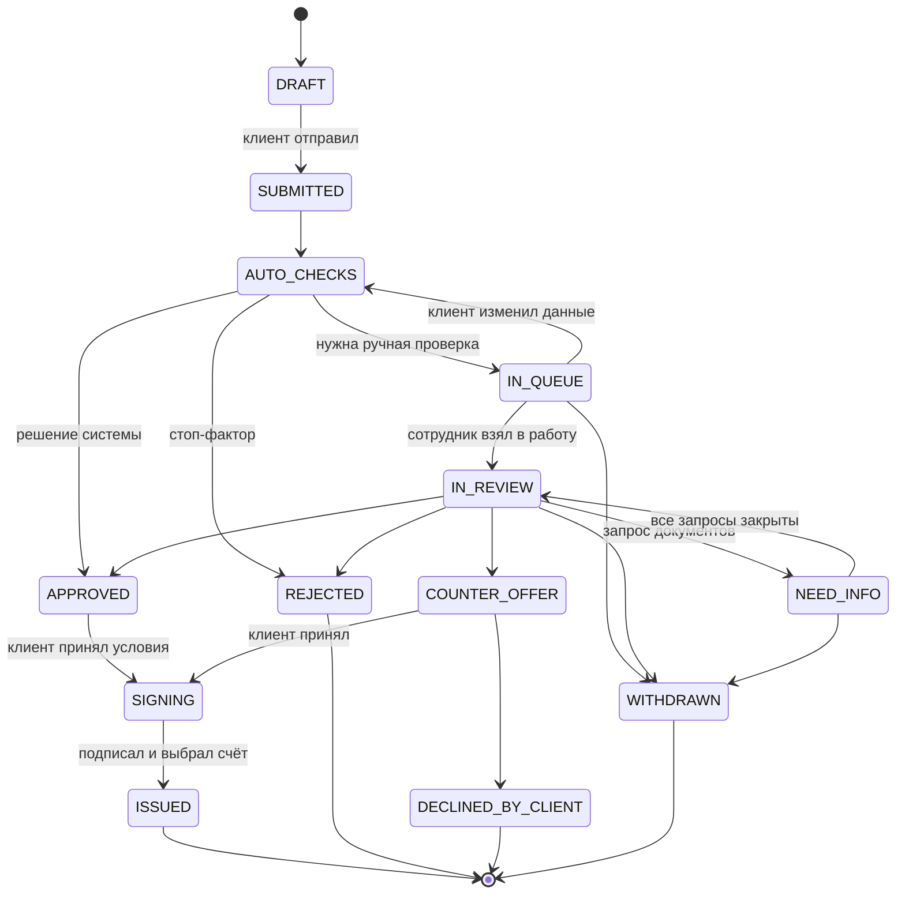

# Бизнес кабинет — кредитный конвейер для малого бизнеса

Прототип «умного кредитного кабинета предпринимателя»: клиентский путь и внутренняя обработка заявки в банке — один процесс на общих данных.
React 18 + TypeScript + Vite + React Router. Только фронтенд: «сервер» — моки за интерфейсами, данные синтетические, LLM и внешние запросы не используются.

## Запуск

Нужен Node.js 22.18+ (тесты запускают `.ts` напрямую).

```bash
cd front
npm install
npm run dev        # http://localhost:5173
npm test           # домен, скоринг, кредитная логика, сид
npm run build      # проверка типов + сборка в dist/
```

## Роли и демо-входы

| Роль | Кто | Как войти |
| --- | --- | --- |
| Предприниматель | Юлия Иванова, руководитель ООО «Пример» | «Я предприниматель» → «Демо-вход» или `/?demo` |
| Сотрудник банка | Анна Смирнова, андеррайтер | «Я сотрудник банка» → «Демо-вход: Анна» или `/?demo=bank` |
| Второй сотрудник | Павел Орлов, старший андеррайтер | «Я сотрудник банка» → «Демо-вход: Павел» — второе подтверждение решений Анны |

Пароль не сохраняется — в демо подходит любой. Клиент не попадает в `/bank/*`, сотрудник — в клиентские разделы, без входа — на `/login`.

### Две вкладки для демо

1. Вкладка 1: `http://localhost:5173/?demo` — клиент.
2. Вкладка 2: `http://localhost:5173/?demo=bank` — сотрудник.

Данные общие (localStorage), а кто вошёл — своё у каждой вкладки (sessionStorage). Действия в одной вкладке сразу видны в другой: изменения приходят через событие `storage`.
«Сбросить демо-данные» (меню профиля в обоих кабинетах) возвращает исходное состояние.

## Сквозной сценарий

1. Клиент: «Финансирование» → «Купить оборудование» → 3,5 млн на 36 мес., дифференцированный платёж → компания из ЕГРЮЛ одним нажатием («Всё верно») → «Использовать демо-выписку» (выручка и кредиты подставятся) → «Заполнить все документы (демо)» → три согласия → «Отправить заявку».
2. На карточке заявки идут авто-проверки; заявка уходит «На рассмотрение», потому что сумма выше авто-лимита 3 млн.
3. Сотрудник: «Заявки» → «Взять в работу» → вкладка «Скоринг» → «Запросить документы» → бухгалтерская отчётность с комментарием.
4. Клиент: точка на колокольчике, запрос с типом и сроком → «Загрузить» → сообщение специалисту.
5. Сотрудник: заявка наверху «Мои проверки» с бейджами «Новые документы», «Новое сообщение» → вкладки «Скоринг», «Деньги», «Как принято решение» → ответ → «Контрпредложение»: сумма из вариантов системы, код причины, обоснование.
6. Клиент: «Вы просили / Банк предлагает» → «Принять предложение» → подписание (симуляция) → выбор счёта → «Кредит выдан».
7. Сотрудник: «История» — ход проверки и итоговые условия со ставкой.

Ещё: изменение суммы в «На рассмотрении» (№ 20103), отказ с причиной и новая заявка с предзаполнением, отзыв (№ 20102), отказ от встречного предложения (№ 20104), авто-одобрение (оборотные средства до 3 млн), стоп-факторы (ИНН ниже), перезагрузка страницы во время проверок.

### Демо-компании для «Подать от другой компании»

| ИНН | Компания | Что покажет |
| --- | --- | --- |
| 7732567898 | ООО «Орион» | ликвидирована — мастер не даст подать заявку |
| 771956789000 | ИП Новикова | бизнесу 4 месяца — меньше 6, заявка недоступна |
| 770367890190 | ИП Белова | 10 месяцев — предупреждение, но подать можно |
| 7725123450 | ООО «Комета» | текущая просрочка в БКИ — авто-отказ на авто-проверках |
| 7701111110 | ООО «АльфаТех» | обороты за 3 мес. на 28% ниже среднего за год |
| любой валидный | — | компания генерируется детерминированно по ИНН |

Все ИНН и ОГРН синтетические и проходят контрольные суммы (`scripts/gen-requisites.ts`).

## Стейт-машина заявки



Финальные статусы: ISSUED, REJECTED, DECLINED_BY_CLIENT, WITHDRAWN. Черновик не отзывается, а удаляется. Переходы — `src/domain/stateMachine.ts`: недопустимый переход бросает `TransitionError`, каждое изменение заявки пишет событие в `history`.

Клиент видит этапы **Параметры → Проверка → Решение → Подписание → Выдача** и строку «Что дальше» (`src/domain/statusText.ts`).

## Продукты (`src/config/products.ts`)

| Цель | Продукт | Сумма, ₽ | Срок, мес. | Ставка, % | Платежи | Обязательные документы |
| --- | --- | --- | --- | --- | --- | --- |
| Пополнить оборотные средства | Оборотный кредит | 300 тыс. – 30 млн | 3–24 | 21 | аннуитет, дифференц. | выписка, бухотчётность |
| Закрыть кассовый разрыв | Кредитная линия | 300 тыс. – 30 млн | 1–18 | 22 | проценты, долг в конце | выписка |
| Купить оборудование | Инвестиционный кредит | 500 тыс. – 50 млн | 12–60 | 19 | аннуитет, дифференц., отсрочка 1–3 мес. | выписка, счёт поставщика |
| Купить транспорт или спецтехнику | Кредит на транспорт | 300 тыс. – 50 млн | 12–60 | 19 | аннуитет, дифференц. | выписка, договор купли-продажи |
| Коммерческая недвижимость | Под залог недвижимости | 1 – 150 млн | 12–120 | 18 | аннуитет, дифференц. | выписка, договор или смета |
| Развивать бизнес | Кредит на развитие | 500 тыс. – 30 млн | 12–60 | 21 | аннуитет, дифференц., отсрочка 1–3 мес. | выписка, бизнес-план |
| Исполнить госконтракт | Кредит под контракт | 300 тыс. – 30 млн | 1–24 | 20 | проценты, долг в конце | выписка, госконтракт |
| Рефинансировать кредиты | Рефинансирование | 500 тыс. – 150 млн | 12–120 | 19 | аннуитет, дифференц. | выписка, справка о задолженности |

Шаг суммы — 50 тыс., авто-лимит — 3 млн. Срок работы бизнеса меньше 12 месяцев — предупреждение, меньше 6 — стоп-фактор. Ставки ориентировочные.

Графики (`src/domain/finance.ts`): месячная ставка = годовая / 12 / 100, без комиссий; округление до копеек на каждой строке; последний платёж закрывает остаток. Аннуитет, дифференцированный, проценты ежемесячно с долгом в конце, аннуитет с отсрочкой (первые N месяцев — только проценты).

## Расчёт по ТЗ (`docs/TZ_credit_pipeline.md`)

Весь расчёт — в мок-слое (`src/mocks/*`), экраны только показывают результат. Пороги и параметры политики — в `src/config/policy.ts` (версия `demo-2026-10-23`), справочник кодов маршрута — в `src/config/routeCodes.ts`.

### Скоринговая карта (`src/mocks/scoring.ts`)

**S = сумма пяти характеристик**, без базового балла. Диапазон 300–660, чем выше — тем ниже риск.

| Характеристика | Категории → очки |
| --- | --- |
| Срок деятельности | < 12 мес. — 60 · 12–24 — 90 · 24–36 — 105 · 36–60 — 120 · ≥ 60 — 135 |
| Кредитная история компании и руководителя (худшее за 24 мес.) | > 90 дн. 60 · 30–90 дн. 100 · 1–29 дн. 135 · истории нет у обоих 120 · без просрочек 160 |
| Тренд выручки: последние 3 мес. / предыдущие 3 | < 0,7 или нет данных — 50 · 0,7–0,9 — 80 · 0,9–1,0 — 100 · 1,0–1,1 — 110 · ≥ 1,1 — 125 |
| Налоговая дисциплина | долг выше порога S06 — 60 · разовые задержки или небольшой долг — 100 · регулярно, без долгов — 130 |
| Отрасль по ОКВЭД | торговля 45–47 — 92 · производство 10–33 и B2B-услуги — 110 · общепит 56, стройка 41–43 — 70 · прочее — 92 |

PD: `factor = 20 / ln 2`, `offset = 600 − factor · ln 50`, `odds = exp((S − offset) / factor)`, `PD = 1 / (1 + odds)`. Калибровка демонстрационная, не обучена на реальных данных.

Группы: **A ≥ 640, B 610–639, C 580–609, D 550–579, E < 550**. Пример из ТЗ: 120 + 160 + 110 + 130 + 92 = **612** → odds 75,8 : 1 → PD 1,30% → **B**.

### Деньги (`src/mocks/affordability.ts`)

| Метрика | Формула | Пороги |
| --- | --- | --- |
| CF | Rev · (1 − v) − Fixed, среднемесячно | CF ≤ 0 — флаг, долг/CF не считается |
| DSCR | CF / (DS + A_new) | ≥ 1,25 норма · 1,1–1,25 пограничная · < 1,0 запрет одобрения |
| DSCR при стрессе | ((1 − v) · Rev · 0,8 − Fixed) / (DS + A_new) | ≥ 1,0 норма · 0,9–1,0 пограничная · < 0,9 запрет |
| Долг / CF | (текущий долг + новый кредит) / (12 · CF) | ≤ 3 норма · 3–4 пограничная |
| DSCR слабого периода | худшие 3 месяца подряд, только при CV > 0,3 | < 1 — G11 |
| PTI | A_new / Rev | справочно, в решении не участвует |

A_new — максимальный платёж по графику (у дифференцированного — первый). DS — платежи по БКИ; если платежа нет — аннуитет остатка на 24 мес. под 20%. Лимит — наибольшая сумма на запрошенный срок, при которой метрики в норме (авто) или в пограничной зоне (ручной), не больше 50% годовой выручки и полномочий.

### Маршрут, шаги 0–8 (`src/mocks/creditPolicy.ts`)

| Шаг | Что проверяем | Коды | Итог |
| --- | --- | --- | --- |
| 0 | валидация и согласия | V01–V08 | заявка не уходит |
| 1 | жёсткие стопы — проверяются все сразу | H01–H09, S01X | автоотказ, клиенту нейтральный текст |
| 2 | полнота и свежесть сведений | D01–D14 | NEED_INFO с системным запросом |
| 3 | финансовый отказ | F01 группа D–E, F02 CF ≤ 0, F03 DSCR < 1 и нет вариантов | автоотказ |
| 4 | мягкие стопы | S01–S10 | ручная проверка, снимаются с кодом причины |
| 5 | лимит, залог, полномочия | G01–G03, G09 | ручная проверка |
| 6 | группа C и пограничные показатели | G04–G08, G10, G11 | ручная проверка |
| 7 | контрпредложение | C01–C03 | авто-COUNTER_OFFER с вариантами |
| 8 | всё в норме | — | авто-одобрение (группа A — ставка на 1 п.п. ниже) |

Каждый пересчёт сохраняет `scoring`, `metrics`, `route` (статус, шаг, основной и все коды, фраза) и `trace` — лестницу шагов, которую сотрудник видит на вкладке «Как принято решение».

### Решение сотрудника (`previewTerms`, `makeDecision` в `src/mocks/operations.ts`)

- «Одобрить» и «Одобрить на других условиях» запрещены при H-коде, группе D–E, CF ≤ 0, DSCR < 1,0, стрессе < 0,9, сумме выше лимита + 10% и неснятых S-кодах; причина видна в подсказке кнопки.
- Форма пересчитывает метрики на лету через `api.applications.preview`; код причины и обоснование ≥ 20 символов обязательны.
- Мягкий стоп снимается с кодом причины (W-01…W-04), доказательством и обоснованием; после снятия — пересчёт.
- Решение вопреки рекомендации (и любое одобрение группы C) ждёт второго подтверждения другим сотрудником; всё пишется в историю.

## Смоделированные интеграции и допущения

| Интеграция | Мок | Допущения |
| --- | --- | --- |
| ЕГРЮЛ / ЕГРИП | `mocks/registry.ts` | 16 синтетических компаний; неизвестный валидный ИНН — детерминированная генерация; невалидный — ошибка |
| БКИ | `mocks/bki.ts` | кредиты, долг, платежи, текущая и закрытые просрочки — детерминированно по ИНН |
| Выписка по счёту | `mocks/statement.ts` | содержимое файла не читается: выручка, расходы и CF за 12 месяцев генерируются по ИНН |
| ФНС, ФССП, суды, Федресурс, перечни | `mocks/sources.ts` | по умолчанию чисто; отклонения заданы для демо-компаний |
| Авто-проверки | `mocks/pipeline.ts` (шаги — в `mocks/operations.ts`) | шаги ЕГРЮЛ → БКИ → выписка → внешние источники → деньги → скоринг → маршрут за 2–4 с; переживают перезагрузку; ведёт одна вкладка (блокировка с перехватом через 3 с) |
| Подписание и выдача | `operations.ts` | симуляция: подпись и зачисление не выполняются |

Прочие допущения: рабочие дни — без праздников; срок проверки — 2 рабочих дня от поступления; ответ на запрос документов — 10 рабочих дней; предложение действует 30 дней; файлы хранятся только как метаданные (имя, размер, тип).

Экраны не импортируют моки: всё идёт через `src/api` (контракты — `api/contracts.ts`). Методы асинхронные, с задержкой 300–800 мс. Для настоящего backend достаточно заменить реализацию в `api/index.ts`.

## Изменение заявки после отправки

| Статус | Что можно менять | Что происходит |
| --- | --- | --- |
| SUBMITTED, AUTO_CHECKS | ничего | проверка идёт несколько секунд |
| IN_QUEUE | сумму, срок, тип платежа, финансы, документы | повторные авто-проверки (IN_QUEUE → AUTO_CHECKS) |
| IN_REVIEW, NEED_INFO | то же, плюс загрузка запрошенного | версия +1, изменения в `changes` и истории, пересчёт скоринга и маршрута, плашка «Клиент изменил данные» у сотрудника, сообщение в переписке |
| APPROVED и дальше | ничего | только отказ от предложения и новая заявка |

Компанию (ИНН) после отправки изменить нельзя.

## Демо-данные (`src/mocks/seed.ts`)

Все даты — смещения от текущего момента, баллы, метрики и маршрут считает модель (сид проходит через те же операции и пайплайн). Номера заявок уникальны и общие для клиента и сотрудника.

- Клиент (ООО «Пример»): черновик 20101, NEED_INFO 20102 (запрос выписки за прошлый месяц и сообщение Анны), IN_REVIEW 20103 (новые документы), COUNTER_OFFER 20104, REJECTED 20105, ISSUED 20106.
- Очередь: 20111 Маяк (B, G01), 20112 Гранит (C, G05, DSCR 1,20, просрочен срок проверки), 20113 Полюс (A), 20114 Белова (C, S01); 20115 у Павла Орлова — только просмотр.
- Авто-решения системы: 20116 Кузнецов (D, F01), 20117 Соколова (E), 20118 Вектор (авто-контрпредложение C01), 20119 Комета (H09).
- «Мои проверки» Анны: 20121 АльфаТех (C, DSCR 0,70 — «Одобрить» заблокировано), 20103, 20122 Морозова (A, готова к решению), 20123 Ромашка (H08 после пересчёта), 20102 и 20124 Север (DSCR 0,98, просрочен) — ждут клиента.
- «История» Анны: 20131 выдан, 20132 ждёт подписания, 20133 клиент отказался, 20104 и 20105 клиента, 20134 отозвана во время проверки.

`node scripts/seed-report.ts` печатает статус, балл, группу, PD, DSCR, стресс, долг/CF и фразу маршрута по каждой заявке сида.

## Структура

```
src/
  domain/     типы, стейт-машина, тексты статусов, реквизиты, графики, даты, уведомления (+ тесты)
  config/     продукты и цели, типы документов, причины отказа, быстрые вопросы
  api/        контракты и точка подключения реализации
  mocks/      хранилище, реестр, БКИ, выписка, скоринг, кредитная логика, пайплайн, операции, сид, помощник (+ тесты)
  store/      сессия вкладки, подписка на данные, асинхронные действия
  pages/      LoginPage, client/* — кабинет предпринимателя, bank/* — кабинет сотрудника
  components/ каркас, сайдбар с логотипом-кнопкой, плашки, этапы, графики, документы, переписка
  art/        маскот, ленты, иллюстрации
  styles/     global, layout, pages, wizard, chat, bank
```
