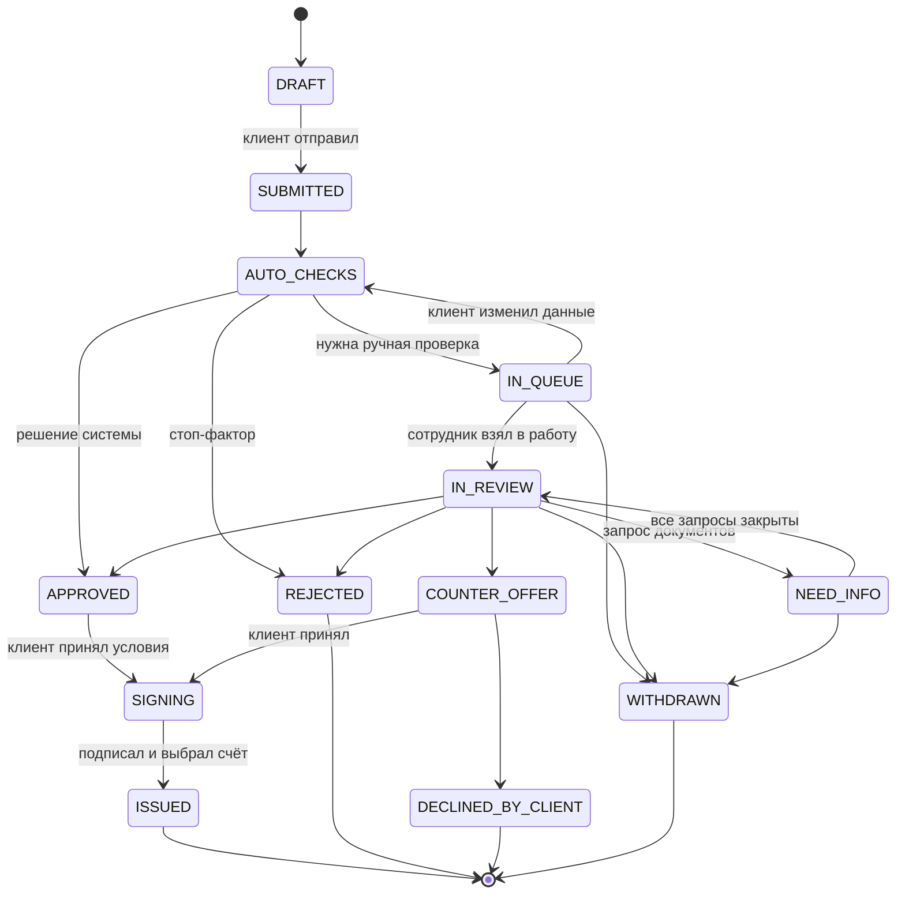

# Бизнес кабинет — кредитный конвейер для малого бизнеса

Прототип «умного кредитного кабинета предпринимателя»: клиентский путь и внутренняя обработка заявки в банке — один процесс на общих данных.
React 18 + TypeScript + Vite + React Router. Данные заявок хранит FastAPI-бэкенд в SQLite (`../backend`, см. его README): черновики, документы, статусы, решения и история живут на сервере. Данные синтетические, LLM и внешние запросы не используются; ЕГРЮЛ, БКИ и выписка — моки на стороне бэкенда, помощник-бот — мок во фронте (`src/mocks/bot.ts`).

## Запуск

Нужен Node.js 22.18+ (тесты запускают `.ts` напрямую).

Сначала бэкенд (иначе кабинет покажет «Сервер недоступен»):

```bash
cd backend
python -m venv venv && venv/Scripts/activate      # Windows; на macOS/Linux: source venv/bin/activate
pip install -r requirements.txt
uvicorn main:app --port 8000                       # http://localhost:8000/docs
```

Затем фронт:

```bash
cd front
npm install
npm run dev        # http://localhost:5173
npm test           # домен: стейт-машина, графики платежей, реквизиты
npm run build      # проверка типов + сборка в dist/
```

Адрес бэкенда — `VITE_API_URL` (по умолчанию `http://localhost:8000`).

## Роли и демо-входы

| Роль | Кто | Как войти |
| --- | --- | --- |
| Предприниматель | Юлия Иванова, руководитель ООО «Пример» | «Я предприниматель» → «Демо-вход» или `/?demo` |
| Сотрудник банка | Анна Смирнова, андеррайтер | «Я сотрудник банка» → «Демо-вход» или `/?demo=bank` |

Пароль не сохраняется — в демо подходит любой. Клиент не попадает в `/bank/*`, сотрудник — в клиентские разделы, без входа — на `/login`.

### Две вкладки для демо

1. Вкладка 1: `http://localhost:5173/?demo` — клиент.
2. Вкладка 2: `http://localhost:5173/?demo=bank` — сотрудник.

Данные общие — они на сервере, а кто вошёл — своё у каждой вкладки (sessionStorage). Фронт опрашивает счётчик изменений бэкенда (`GET /api/revision`), поэтому действия в одной вкладке появляются в другой за секунду-две, а авто-проверки идут на сервере и переживают перезагрузку страницы.
«Сбросить демо-данные» (меню профиля в обоих кабинетах) пересоздаёт БД бэкенда с демо-данными.

## Сквозной сценарий

1. Клиент: «Финансирование» → «Купить оборудование» → 3,5 млн на 36 мес., дифференцированный платёж → компания из ЕГРЮЛ одним нажатием («Всё верно») → «Использовать демо-выписку» (выручка и кредиты подставятся) → «Заполнить все документы (демо)» → три согласия → «Отправить заявку».
2. На карточке заявки идут авто-проверки; заявка уходит «На рассмотрение», потому что сумма выше авто-лимита 3 млн.
3. Сотрудник: «Заявки» → «Взять в работу» → вкладка «Скоринг» → «Запросить документы» → бухгалтерская отчётность с комментарием.
4. Клиент: точка на колокольчике, запрос с типом и сроком → «Загрузить» → сообщение специалисту.
5. Сотрудник: заявка наверху «Мои проверки» с бейджами «Новые документы», «Новое сообщение» → ответ → «Перейти к решению» → «Предложить другие условия»: 3 млн, обоснование.
6. Клиент: «Вы просили / Банк предлагает» → «Принять предложение» → подписание (симуляция) → выбор счёта → «Кредит выдан».
7. Сотрудник: «История» — ход проверки и итоговые условия со ставкой.

Ещё: изменение суммы в «На рассмотрении» (№ APP-1003), отказ с причиной и новая заявка с предзаполнением, отзыв (№ APP-1002), отказ от встречного предложения (№ APP-1004), авто-одобрение (оборотные средства до 3 млн), стоп-факторы (ИНН ниже), перезагрузка страницы во время проверок.

### Демо-компании для «Подать от другой компании»

| ИНН | Компания | Что покажет |
| --- | --- | --- |
| 7732567898 | ООО «Орион» | ликвидирована — мастер не даст подать заявку |
| 771956789000 | ИП Новикова | бизнесу 4 месяца — меньше 6, заявка недоступна |
| 770367890190 | ИП Белова | 10 месяцев — предупреждение, но подать можно |
| 7725123450 | ООО «Комета» | текущая просрочка в БКИ — авто-отказ на авто-проверках |
| 7701111110 | ООО «АльфаТех» | обороты за 3 мес. на 28% ниже среднего за год |
| любой валидный | — | компания генерируется детерминированно по ИНН |

Все ИНН и ОГРН синтетические и проходят контрольные суммы (`scripts/gen-requisites.ts`).

## Стейт-машина заявки



Финальные статусы: ISSUED, REJECTED, DECLINED_BY_CLIENT, WITHDRAWN. Черновик не отзывается, а удаляется. Переходы — `src/domain/stateMachine.ts`: недопустимый переход бросает `TransitionError`, каждое изменение заявки пишет событие в `history`.

Клиент видит этапы **Параметры → Проверка → Решение → Подписание → Выдача** и строку «Что дальше» (`src/domain/statusText.ts`).

## Продукты (`src/config/products.ts`)

| Цель | Продукт | Сумма, ₽ | Срок, мес. | Ставка, % | Платежи | Обязательные документы |
| --- | --- | --- | --- | --- | --- | --- |
| Пополнить оборотные средства | Оборотный кредит | 300 тыс. – 30 млн | 3–24 | 21 | аннуитет, дифференц. | выписка, бухотчётность |
| Закрыть кассовый разрыв | Кредитная линия | 300 тыс. – 30 млн | 1–18 | 22 | проценты, долг в конце | выписка |
| Купить оборудование | Инвестиционный кредит | 500 тыс. – 50 млн | 12–60 | 19 | аннуитет, дифференц., отсрочка 1–3 мес. | выписка, счёт поставщика |
| Купить транспорт или спецтехнику | Кредит на транспорт | 300 тыс. – 50 млн | 12–60 | 19 | аннуитет, дифференц. | выписка, договор купли-продажи |
| Коммерческая недвижимость | Под залог недвижимости | 1 – 150 млн | 12–120 | 18 | аннуитет, дифференц. | выписка, договор или смета |
| Развивать бизнес | Кредит на развитие | 500 тыс. – 30 млн | 12–60 | 21 | аннуитет, дифференц., отсрочка 1–3 мес. | выписка, бизнес-план |
| Исполнить госконтракт | Кредит под контракт | 300 тыс. – 30 млн | 1–24 | 20 | проценты, долг в конце | выписка, госконтракт |
| Рефинансировать кредиты | Рефинансирование | 500 тыс. – 150 млн | 12–120 | 19 | аннуитет, дифференц. | выписка, справка о задолженности |

Шаг суммы — 50 тыс., авто-лимит — 3 млн. Срок работы бизнеса меньше 12 месяцев — предупреждение, меньше 6 — стоп-фактор. Ставки ориентировочные.

Графики (`src/domain/finance.ts`): месячная ставка = годовая / 12 / 100, без комиссий; округление до копеек на каждой строке; последний платёж закрывает остаток. Аннуитет, дифференцированный, проценты ежемесячно с долгом в конце, аннуитет с отсрочкой (первые N месяцев — только проценты).

## Скоринг (`backend/engine.py`)

Шкала 0–1000, **чем выше балл, тем ниже риск**. База 500, затем факторы:

| Фактор | Условие → баллы |
| --- | --- |
| Срок работы бизнеса | < 12 мес: −80; 12–36: 0; > 36: +60 |
| Платёж / средний оборот за 3 мес | ≤ 20%: +120; ≤ 35%: +40; ≤ 50%: −60; > 50%: −150 |
| Долговая нагрузка: (долг по БКИ + новый кредит) / выручка за 12 мес | ≤ 30%: +100; ≤ 60%: 0; ≤ 100%: −100; > 100%: −200 |
| Кредитная история | кредиты без просрочек: +80; кредитов нет: 0; закрытые просрочки: −80 за каждую, не больше −160 |
| Динамика: оборот за 3 мес к обороту за 12 мес | ≥ +10%: +50; от −10%: 0; от −25%: −60; < −25%: −120 |
| Сумма кредита / выручка за 12 мес | ≤ 25%: +50; ≤ 50%: 0; > 50%: −80 |

Итог ограничен 0–1000. Правила версионируются (`demo-v1`): заявка запоминает версию при создании, и все пересчёты идут по ней. Рядом с баллом сервер считает PTI = (текущие платежи + новый платёж) / (оборот × 0,25); он виден сотруднику на вкладке «Скоринг» вместе с историей расчётов. Зоны: 0–399 — высокий риск, 400–699 — ручная проверка, 700+ — авто-одобрение. Платёж — максимальный по графику (у дифференцированного — первый). У каждого фактора есть пояснение простым языком.

**Стоп-факторы** (сразу отказ): компания ликвидирована; текущая просрочка в БКИ; бизнесу меньше 6 месяцев.

## Кредитная логика (`backend/engine.py`)

Отдельно от скоринга:

1. Есть стоп-фактор → REJECTED, причина из `config/rejectReasons.ts`, решение `system`.
2. Балл ≥ 700, сумма ≤ авто-лимита продукта и все обязательные документы есть → APPROVED на запрошенных условиях; ставка — базовая, при балле ≥ 800 — на 1 п.п. ниже.
3. Иначе → IN_QUEUE с рекомендацией: «одобрить», «встречное предложение: до X ₽» или «отказ». X — максимальная сумма, при которой платёж ≤ 35% среднего оборота за 3 мес., округлённая вниз до 50 тыс. и не ниже минимума продукта.
4. Балл < 400 — тоже в очередь, с рекомендацией отказа: решение принимает человек.

Причина, по которой система не решила сама, сохраняется («Балл в зоне ручной проверки», «Сумма выше авто-лимита 3 000 000 ₽», «Не хватает документов: …») и видна сотруднику.

## Смоделированные интеграции и допущения

| Интеграция | Где | Допущения |
| --- | --- | --- |
| ЕГРЮЛ / ЕГРИП | `GET /api/registry/{inn}`, `backend/sources.py` | 20 синтетических компаний; неизвестный валидный ИНН — детерминированная генерация; невалидный — ошибка 422 |
| БКИ | `GET /api/bki/{inn}` | кредиты, долг, платежи, текущая и закрытые просрочки — детерминированно по ИНН |
| Выписка по счёту | `GET /api/statement/{inn}` | содержимое файла не читается: обороты за 12 месяцев генерируются по ИНН |
| Авто-проверки | фоновый поток бэкенда, `backend/lifecycle.py` | шаги ЕГРЮЛ → БКИ → выписка → скоринг → решение за 2–4 с; состояние шагов в БД, поэтому переживают перезагрузку страницы и сервера |
| Подписание и выдача | `POST /api/applications/{id}/client-response` | симуляция: подпись и зачисление не выполняются |
| Помощник | `src/mocks/bot.ts` | ответы по правилам; переписка с ботом хранится в localStorage |

Прочие допущения: рабочие дни — без праздников; срок проверки — 1 рабочий день от поступления; запрос документов — по умолчанию +2 рабочих дня; предложение действует 5 дней; файлы хранятся только как метаданные (имя, размер, тип).

Экраны не знают про HTTP: всё идёт через `src/api` (контракты — `api/contracts.ts`, реализация — `api/server.ts`). Заявки лежат в кэше для React и обновляются из ответов сервера и опроса.

## Изменение заявки после отправки

| Статус | Что можно менять | Что происходит |
| --- | --- | --- |
| SUBMITTED, AUTO_CHECKS | ничего | проверка идёт несколько секунд |
| IN_QUEUE | сумму, срок, тип платежа, финансы, документы | повторные авто-проверки (IN_QUEUE → AUTO_CHECKS), новый расчёт записывается в историю скоринга |
| IN_REVIEW, NEED_INFO | то же, плюс загрузка запрошенного | версия +1, изменения в `changes` и истории, пересчёт скоринга по той же версии правил, плашка «Клиент изменил данные» у сотрудника, сообщение в переписке |
| APPROVED и дальше | ничего | только отказ от предложения и новая заявка |

Компанию (ИНН) после отправки изменить нельзя.

## Демо-данные (`backend/seed.py`)

Все даты — смещения от текущего момента, баллы считает модель (сид проходит через те же операции и конвейер, что и боевые заявки). Номера заявок — `APP-xxxx`, общие для клиента и сотрудника; новые заявки получают номера с APP-1042.

- Клиент (ООО «Пример», `CLIENT-001`): черновик APP-1001, NEED_INFO APP-1002 (запрос выписки за прошлый месяц и сообщение Анны), IN_REVIEW APP-1003 (новые документы), COUNTER_OFFER APP-1004, REJECTED APP-1005, ISSUED APP-1006.
- Очередь: APP-1011–1014 с разными зонами скоринга (APP-1012 просрочена по сроку проверки), APP-1015 у Павла Орлова — только просмотр.
- «Мои проверки» Анны: APP-1021 АльфаТех (падающие обороты), APP-1003, APP-1022 (готова к решению), APP-1002 и APP-1024 (просрочена) — ждут клиента.
- «История» Анны: APP-1031 выдан, APP-1032 ждёт подписания, APP-1033 клиент отказался, APP-1004 и APP-1005 клиента, APP-1034 отозвана во время проверки.
- Демо-профили конвейера (кнопки на экране входа, `CLIENT-101…104`): APP-1036–1039 с автоматическим одобрением, встречным предложением, запросом выписки и отказом.

Тестовые заявки для любого клиента: `POST /api/clients/{id}/test-applications` или `python seed.py --client CLIENT-001` в `backend/`.

## Структура

```
src/
  domain/     типы, стейт-машина, тексты статусов, реквизиты, графики, даты, уведомления (+ тесты)
  config/     продукты и цели, типы документов, причины отказа, быстрые вопросы
  api/        контракты и HTTP-клиент бэкенда (server.ts)
  mocks/      помощник-бот (bot.ts)
  store/      сессия вкладки, подписка на данные, асинхронные действия
  pages/      LoginPage, client/* — кабинет предпринимателя, bank/* — кабинет сотрудника
  components/ каркас, сайдбар с логотипом-кнопкой, плашки, этапы, графики, документы, переписка
  art/        маскот, ленты, иллюстрации
  styles/     global, layout, pages, wizard, chat, bank
```
